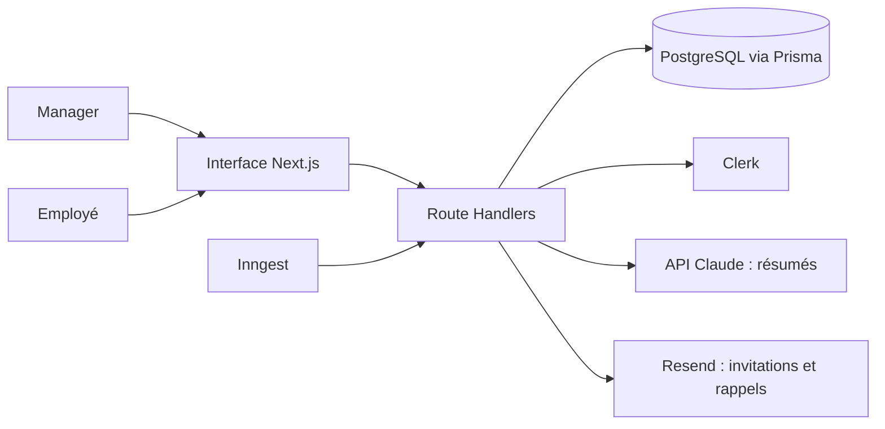

# Echowork : étude de cas

> SaaS de feedback collaboratif pour startups et PME : les managers lancent des demandes de retours, les employés répondent de façon anonyme ou signée, et l'IA résume ce qui ressort. En ligne sur [echowork.fr](https://echowork.fr).

Conçu, développé et déployé seul, de bout en bout. Le code source est privé : ce dépôt présente le produit, l'architecture et les choix techniques.

## Le produit

- Trois rôles : administrateur, manager, employé. Invitation par email, onboarding en quelques minutes.
- Demandes de feedback avec contexte, questions et date limite, campagnes récurrentes et rappels automatiques.
- Retours anonymes ou signés, au choix de l'employé, à chaque réponse.
- Résumé des retours par IA, tableaux de bord et export PDF.
- Offres Free, Pro et Business.

## Stack

| Couche | Technologies |
|---|---|
| Front | Next.js 14 (App Router), React 18, TypeScript, Tailwind CSS, Radix UI, Recharts |
| Back | Route Handlers Next.js, Prisma, PostgreSQL, Zod, React Hook Form |
| Auth | Clerk |
| Tâches de fond | Inngest |
| IA | API Anthropic Claude |
| Emails | Resend et React Email |
| Infra | Vercel, Vercel Analytics |

## Architecture

## Choix techniques

### Anonymat réel

Quand un employé choisit l'anonymat, le retour est dissocié de son auteur dès l'enregistrement : le lien n'existe pas en base. Ni le manager, ni l'administrateur, ni l'équipe Echowork ne peuvent remonter à son identité. Dans les petites équipes, l'application prévient qu'une réponse anonyme peut rester identifiable selon le contexte.

### Multi-tenant

Chaque entreprise est un espace isolé, avec ses propres membres, rôles et demandes de feedback. L'authentification repose sur Clerk et les entrées sont validées par des schémas Zod.

### Traitements en arrière-plan

Les tâches planifiées et celles qui n'ont pas à bloquer l'utilisateur passent par Inngest, ce qui les rend fiables et rejouables en cas d'échec.

### Résumés par IA

Les réponses d'une demande sont transmises à l'API Claude, qui produit une synthèse lisible pour le manager, sans qu'il ait à relire chaque réponse.

## Contact

Ayoub Lafdail · [lafdail.dev](https://lafdail.dev) · [LinkedIn](https://www.linkedin.com/in/lafdail)
